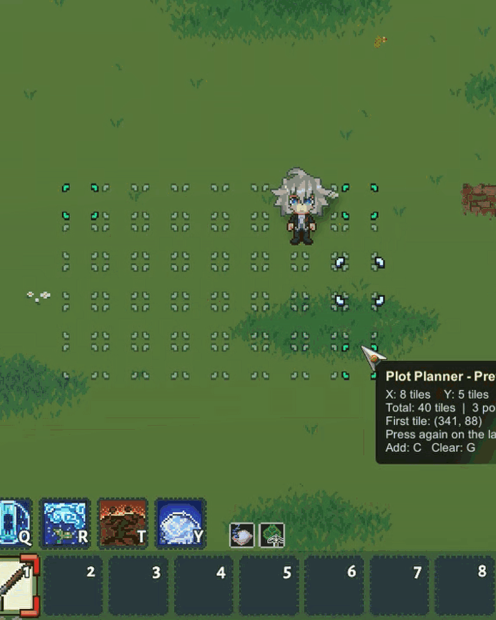

  

<h1 align="center">Shima QoL</h1>

<strong>Make every day in Sun Haven feel a little smoother.</strong>

Helpful tools for your farm. More ways to make a home. More moments to share with friends.

  <a href="https://discord.gg/hWFdr9ayFB">Join the Shima QoL community</a>

Whether you're tending crops, decorating your home, exploring town, or playing with friends, Shima QoL brings everyday conveniences and optional social features together in one customizable **Sun Haven** mod.

## What can Shima QoL do?

| Feature | What it brings to your game |
| --- | --- |
| **Know more at a glance** | Hover over crops, trees, chests, and world objects for useful details, including growth time, fertilizer, fruit counts, chest names, and totem effects or ranges. |
| **Make farm work flow** | Set shortcuts for tools and actions, split item stacks by a fixed amount or percentage, and outline your next farming layout with Plot Planner. |
| **Keep crafting moving** | Link supported crafting stations to storage so finished items are collected automatically, giving you more time for the rest of your day. |
| **Rearrange without the emptying** | Move supported storage with its contents, so changing your farm layout takes fewer trips and less inventory juggling. |
| **Share more with friends** | Give gifts to fellow players, build a player partnership, get married, and invite friends to shared birthday and wedding events. |
| **Bring more life to home** | Give your NPC spouse days off to spend time in their assigned home, with supported indoor routines and additional Lynn conversations. |
| **Settle into your space** | Sit on compatible chairs, couches, and benches, share wide beds, and customize the flooring in your Sun Haven barns. |
| **Enjoy the little conveniences** | Find items by name in the Hardware Store and enable map fast travel for 500 gold per trip. |

## See Shima QoL in action

### World tooltips

Check crop growth and fertilizer details while tending your farm.

  

### Quick Actions

Use action shortcuts to keep everyday farm work moving.

  

### Automation Chest

Link supported crafting stations to storage and collect finished items automatically.

  

### Move storage with its contents

Rearrange your space while keeping the items inside supported storage.

  

### Plot Planner

Outline your next farming layout before putting your tools to work.

  

### Player weddings

Celebrate a player wedding together in Sun Haven.

  

## Make it yours

Choose the features that suit your playthrough. Customize shortcuts, tooltip categories, highlights, colors, and the settings window's appearance. Open the menu with **Insert**, adjust your preferences, and **Save settings**.

## Help shape what comes next

Shima QoL is growing alongside its community. Join fellow Sun Haven players to follow updates, share ideas, talk about the game, and help improve the mod with feedback and bug reports.

**[Join the Discord community →](https://discord.gg/hWFdr9ayFB)**

## Early development, openly shared

Shima QoL is still in early development. Features may be unfinished, bugs can happen, and things will change as the mod grows.

**AI tools are used in the development of Shima QoL**, as part of an ongoing journey to learn coding and mod development. That process is shared openly with the community.

## Release status

**No public download is available yet.** This page introduces the mod while development continues. Follow the [Discord announcements](https://discord.gg/hWFdr9ayFB) for release news. When a build is ready, its compiled mod ZIP will be published on the [Releases page](https://github.com/Shimaryu4k/Shima-QoL/releases).

Want to prepare? See the [installation guide](INSTALL.md) for the mod manager and BepInEx requirements.

Shared features such as automation require matching mod versions on the host and every player. Multiplayer requirements vary by feature, and compatibility is still being tested.

Dependency credits and license information: <a href="THIRD_PARTY_NOTICES.md">third-party notices</a>.
