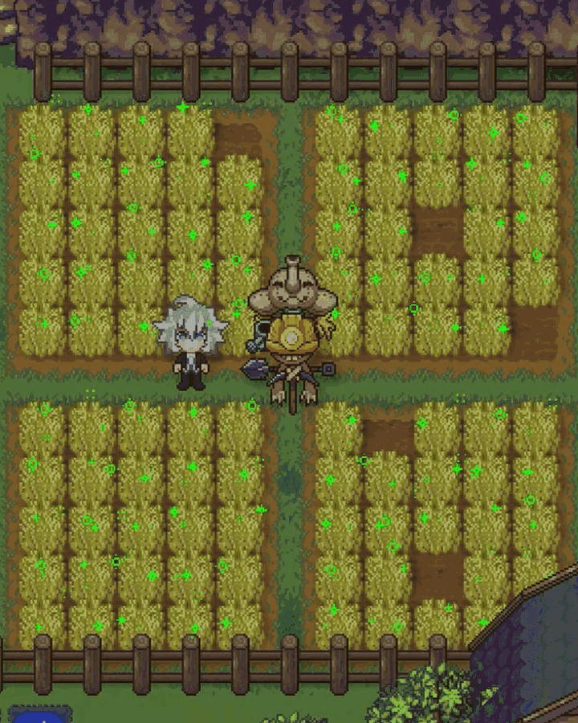
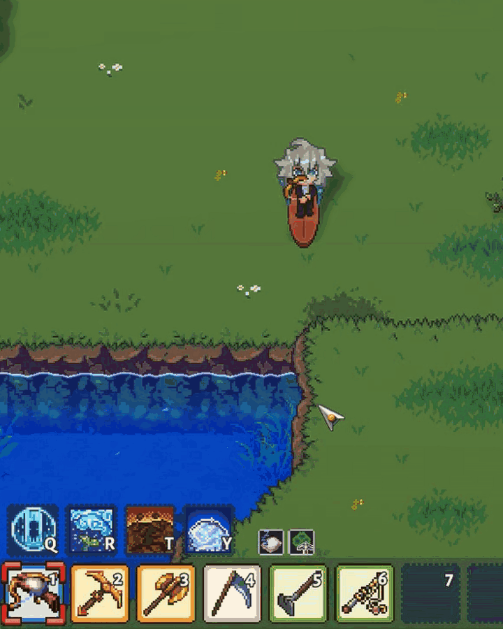
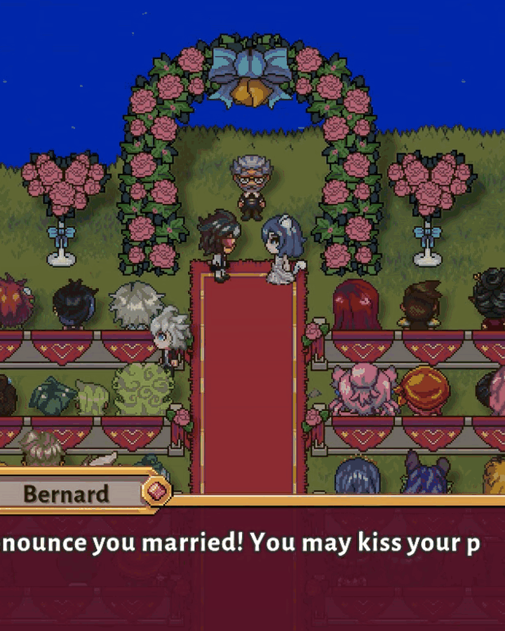

  

<h1 align="center">Shima QoL</h1>

<strong>Make every day in Sun Haven feel a little smoother.</strong>

Tool shortcuts, crafting automation, storage movement, building customization and expanded co-op interactions for Sun Haven.

  <a href="https://github.com/Shimaryu4k/Shima-QoL/releases">Download the Universal release</a> ·
  <a href="https://www.nexusmods.com/sunhaven/mods/568">Nexus Mods</a> ·
  <a href="INSTALL.md">Installation guide</a> ·
  <a href="https://discord.gg/hWFdr9ayFB">Join the community</a>

Choose the features you want in one settings window, with configurable shortcuts and options for farming, decorating and playing together. [Watch the gameplay GIFs below](#see-shima-qol-in-action).

## Main features

### Tool Tip Overlay

Hover over crops, trees, storage, NPCs and world objects to see names and useful details. Check crop growth time and active fertilizer, remaining fruit and chest names. Optional highlights, tile borders and totem/scarecrow ranges help you see what you are pointing at.

### Quick Actions

Assign shortcuts for mining, chopping, hoeing, watering, scything, attacking, fishing and mounts. Use carried tools from your hotbar or backpack, with your previous selection restored afterward. Hold supported tool shortcuts to repeat actions, or enable movement toward the mouse while working.

### Stack Splitter

Use **Alt + right-click** to split stacks in your inventory or storage. Choose a fixed item count or a percentage, and hold to repeat the split.

### Plot Planner

Outline farm plots before building them. Create rectangles or custom shapes, including L-shaped and U-shaped layouts, with a live border, dimensions and tile count. Customize the preview colors and opacity.

### Automation Chest

Link supported crafting stations to storage to collect finished items automatically. Choose Auto or Manual collection for linked stations and manage your links from the settings window.

### Player Interaction

Give gifts to other players, form a partnership, propose with an Engagement Ring and arrange a player wedding with Bernard. Partner interactions include **Cuddle** and **Goodnight**. Invite friends to supported birthday and wedding events; guests can join or decline.

### NPC Settings

Give your married NPC spouse days off to spend time in their assigned Tier 3 home. Supports indoor walking, pauses and available native furniture activities for the 25 supported spouses, plus shared return walks and additional Lynn conversations. Activities depend on each NPC's supported animations.

### Building Modifications

Change flooring inside **Sun Haven barns at levels 1–3**. Each barn keeps its own choice through upgrades and world saves. Hold a flooring item to use **Set Flooring** or **Restore Barn Floor**. Flooring is reusable, and vanilla players continue to see the original barn floor.

## Additional features

| Feature | What you can do |
| --- | --- |
| **Storage Movement** | Move supported storage with its contents using an in-world placement preview. Confirm a valid spot or cancel to keep it where it was. |
| **Sitting** | Sit on compatible chairs, couches and benches using your character's appearance. Supported seated actions include eating and fishing. |
| **Shared Beds** | Share a compatible wide bed with another player using separate pillows. |
| **AFK Bed Rest** | Rest in bed at any hour. In co-op, join the night transition when the other sleep requirements are met and remain resting the next morning. |
| **Hardware Store Search** | Search the Hardware Store catalog by item name. |
| **Map Fast Travel** | Travel from a selected map location for **500 gold**, with native region and repair requirements respected. |
| **Properties** | Claim and name houses or sheds, manage locks and visitor access, and choose an owned Tier 3 home for your NPC spouse. Available through **Game Settings > Properties**. |

## See Shima QoL in action

### World tooltips

Check crop growth and fertilizer details while tending your farm.

  

### Quick Actions

Use action shortcuts to keep everyday farm work moving.

  

### Automation Chest

Link supported crafting stations to storage and collect finished items automatically.

  

### Move storage with its contents

Rearrange your space while keeping the items inside supported storage.

  

### Plot Planner

Outline your next farming layout before putting your tools to work.

  

### Player weddings

Celebrate a player wedding together in Sun Haven.

  

## Installation and settings

Requires **Sun Haven on Windows x64** and **BepInEx 5**. Get the **Universal ZIP** from the [Releases page](https://github.com/Shimaryu4k/Shima-QoL/releases), then follow the [installation guide](INSTALL.md).

Close Sun Haven before installing or updating, and restart afterward. Keep one active ShimaQoL.dll; remove older duplicates and the separate Quick Actions DLL if present.

**Insert** opens the settings window. **Backslash** toggles hover tooltips. Choose features and shortcuts, then **Save settings**.

Some features need shortcuts assigned or options enabled before use. Your choices are saved through the mod's settings window.

## Multiplayer

Shared features such as Automation Chest require matching mod versions on the host and every player. Requirements vary by feature, and multiplayer compatibility is still being tested. Vanilla players and players with barn flooring disabled retain the original barn appearance.

## Help shape what comes next

Shima QoL is growing alongside its community. Join fellow Sun Haven players to follow updates, share ideas, talk about the game, and help improve the mod with feedback and bug reports.

**[Join the Discord community →](https://discord.gg/hWFdr9ayFB)**

## Early development, openly shared

Shima QoL is still in early development. Features may be unfinished, bugs can happen, and things will change as the mod grows.

**AI tools are used in the development of Shima QoL**, as part of an ongoing journey to learn coding and mod development. That process is shared openly with the community.

**[Archive Old Dev Logs](ARCHIVE_OLD_DEV_LOGS.md)** — explore the early prototypes and development history through v0.0.144.

## Release status

**v0.0.144 — Early Access is available!** This prerelease improves barn flooring alignment, including repeating patterns such as Modern Marble, and introduces the Universal release package.

**[Visit the Releases page for downloads and release notes](https://github.com/Shimaryu4k/Shima-QoL/releases)**

Dependency credits and license information: <a href="THIRD_PARTY_NOTICES.md">third-party notices</a>.
